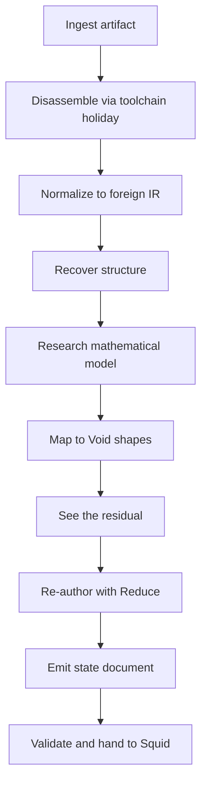
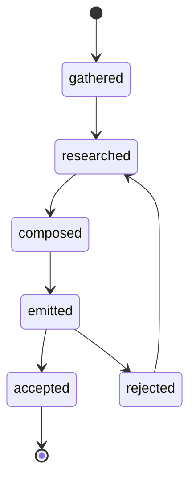

# Void MoleRat — design, integration plan, and the first vertical slice

**Status: planned. Nothing in this document is built.** The concept page is
[`okf/concepts/molerat.md`](../okf/concepts/molerat.md); this file is the rationale, the
integration plan, and the build order. No claim here may be raised to `status:current`
until the OKF page carries a `resource:` link to the code that backs it.

**Agent A, 2026-10-18.** Written in the same directory as agent B's Void Ocean / Void Onda
work. The shared-file discipline is in §8 and in
`MESSAGE_FOR_AGENT_B_molerat-2026-10-18.md`.

---

## 0. What I read, and three corrections to the brief

Read: `okf/index.md` and the pages it links; `README.md`, `CLAUDE.md`, `SETUP.md`,
`void.json`; the sibling messages in this root; `okf/design/what-voidsquid-is-not.md`;
`okf/design/decompilation.md`; `okf/concepts/construct-and-deconstruct.md`,
`recon.md`, `build-surface.md`, `what-a-game-is.md`, `turkey-table-feast.md`, `hosts.md`,
`studio-surfaces.md`, `coral.md`, `scope.md`; `okf/design/three-uses.md`,
`the-forge-for-many-runtimes.md`, `open-questions.md` (S19–S21), `roadmap.md`;
`../VoidCore/SPEC.md` (read-only), `../VoidCore/okf/index.md`, and the Core concept pages
for rune, mantle, holiday, dispatcher, reduce, temper, interaction nets; the recon code and
the dispatcher seam in `src/`.

Three facts differ from the brief, and are recorded rather than papered over:

1. **There are four `MESSAGE_FOR_VOIDSQUID_*` files in this root, not five.** They are
   Void Mago (2026-10-04), Void Jelly (2026-10-05), Latin OS (2026-10-09), and Void Maiz
   (2026-10-17). I did not invent a fifth.
2. **Void Mago is not built in this checkout** (`../VoidMago` has no `build/`). I did not
   build it. `../VoidMago/family.json` carries one authored pairing, so `mago scan` and
   `mago matrix` were not available. I read the manifests and READMEs instead. The brief's
   claim that Squid is one of seven projects Mago cannot compute a verdict for is
   **unverified here**; Squid's root does carry `void.json`. That is a Mago/owner finding,
   not something MoleRat fixes, and I did not add or alter a manifest to make it go away.
3. **Void Core's host-verb registration seam does not exist yet.** SPEC §12 records that
   two hosts have built the §7.2 superset dispatcher and that an added verb is invisible to
   `help`. Void Maiz's `action.hpp` points at the same missing seam. MoleRat therefore
   rides `effect <op>` — the existing holiday boundary — instead of forking Core or Maiz.

I edited no file under `../VoidCore`, `../VoidMaiz`, `../VoidMago`, or any other sibling.

---

## 1. What Void MoleRat is, and what it is not

### 1.1 It is

A **Void-Core-native decompilation and re-expression harness**. It takes a target a person
owns, recovers structure from it, runs an explicit **research phase** that states the
target's mathematical model, maps that model onto the rune/mantle/domain vocabulary, and
**re-authors** the result in the Void idiom so Void Squid can consume it.

Three sentences that keep it aimed:

- **It is a forge, not an artifact.** It produces documents and source in the family's
  idiom. It ships nothing to a target.
- **It is the harness an agent drives, not a second brain.** No model is embedded. The
  agent is external, its answers are validated, and every accepted answer is a dispatcher
  command.
- **It re-expresses, it does not clone.** Byte-perfect decompilation is one input to the
  work, not the goal. The goal is a faithful Void-shaped codebase whose behaviour can be
  compared against the original.

### 1.2 It is not

- Not a replacement for Ghidra, IDA, splat, decomp-toolkit, REA, or `ndstool`. It
  **discovers and invokes** them through the ingress toolchain row of the
  [build surface](../okf/concepts/build-surface.md).
- Not a matching decompiler. Where a community decompilation exists, MoleRat **cites it as
  an oracle**; it does not reimplement the matching loop.
- Not a fork of `rea` or `universal-modder`. It keeps their hard-won lessons (evidence and
  limitations per conclusion; the bridge contract; evidence levels; publish checks) and
  rejects their universal-adapter framing, which both projects say is false in practice.
- Not an LLM feature. Bicho is a sibling holiday; a local model's output is a proposal like
  any other agent answer.
- Not a runtime, a game engine, or a second Void Core. It never computes the target's
  results.
- Not a Mago project. It is a capability inside Void Squid. If the owner later promotes it
  to a sibling repository, it gets its own manifest then, by the owner's decision.

### 1.3 The railguard, applied line by line

| Squid railguard | how MoleRat keeps it |
|---|---|
| §3 no geometry | MoleRat computes no geometry. Meshes, textures, skeletons and draw lists are Void Jelly's; MoleRat carries **references** and residual, never a vertex loop. |
| §4 no `.ink` ownership | MoleRat never parses or writes `.ink`. A re-authored scene is a reference plus a Jelly-owned block, or it is named in the residual. |
| §5 owns no truth | Accepted research and re-authored runes live in the state document. `molerat/out/<run>/run.json` is a **derived cache**: delete it, re-run from inputs and answers, get the same document. |
| §6 the artifact never ships the forge | MoleRat ships nothing. Its output is a state document and source in the Void idiom. If that source is later compiled into a game, it carries no Void Core and no MoleRat. |
| §7 the summary test | The slice proves a seam that is not otherwise proved: the dispatcher + a declared-glyph document + Reduce as a normalizer + a validated handoff to Squid. The research phase is the new claim, and it is testable without a game. |
| §8 the game model's test | Every research and emitted noun is sayable in Core's vocabulary (rune, tag, link, content, rule, holiday); runs in a unit test with no filesystem, network, display or clock; and is recoverable or named in a residual. |

**The one new claim MoleRat makes** is that **research is a first-class pipeline stage with
its own four-verb shape**, not a prose preamble to coding. The forge's verbs are *gather,
compose, see the residual, build*; the research phase has the same shape over knowledge:
gather the literature and the evidence, compose a model and a mapping, see what does not
map, build the translation holiday. That symmetry is the design's spine.

---

## 2. Prior art: what is kept, what is rejected, and how it lands in Void

### 2.1 REA (`morluto/rea`)

| what REA does | keep | reject | in Void terms |
|---|---|---|---|
| drives Ghidra, IDA, JADX, Binwalk, mitmdump and GDB from an agent | the **orchestration** shape: one contract over many engines, local, agent-facing | a generic adapter that pretends every target is the same | an **ingress toolchain** holiday: discovered on the machine, invoked under the effect gate, never linked |
| every conclusion carries *the evidence and limitations behind it* | evidence as first-class content | prose-only evidence with no machine field | `confidence:` tag + `evidence` content + a `residual` rune |
| local analysis; the agent's model provider is the agent's | the person's machine is the boundary | sending targets to a hosted service by default | no model in MoleRat; every external call is a declared effect |

### 2.2 universal-modder (`rehan-remade/universal-modder`)

| what it does | keep | reject | in Void terms |
|---|---|---|---|
| skills + a Python CLI + a reviewed knowledge base for modding games the person owns | the knowledge base as **a mantle of notes**, searchable by tag | per-game skills as the only structure; a mod folder as the output | research records and a provenance mantle |
| the **bridge contract** (ownership table, units and axes, channels, protocol identity, lifecycle, not covered) | the whole schema, as the **translation holiday** for non-mappable behaviour | a claim that one adapter fits all pairs | holiday interface + `controls`/`owns` links + rules + residual |
| six evidence levels, from creator report to real run | a finer `confidence` vocabulary than `verified`/`asserted` | treating a creator report as a run | `confidence:verified|strong|weak|asserted` with the method in `how` |
| the agent decompilation loop: one function, build-and-verify, a cap, commit every match | the **per-function checkpoint** and the oracle discipline | billions of tokens as a strategy | tasks are bounded; each accepted function is a command; the oracle is recorded |
| `um publish check`: no game files, no decompiled code, no keys | the rule, enforced by the forge before anything leaves | — | `molerat verify` checks that the document validates, the residual is present, the IR is not embedded and the synthetic origin is declared; a general bytes/decompiled-code scanner is planned |

### 2.3 The bridge contract, mapped once

From [`decompilation.md`](../okf/design/decompilation.md) §4, restated as MoleRat's holiday
record:

| contract field | MoleRat field | in Void Core |
|---|---|---|
| route and exact versions | `provenance` on the target rune | content + tags |
| ownership table | `ownership` in the holiday record | `controls` / `owns` links; hand-back triggers are rules |
| units and axes | `units` | data on the link; measure runes carry `quantity` |
| channels | `channels` | the holiday's declared interface |
| protocol identity and lifecycle | `lifecycle` | the holiday's interface + rules over its state |
| not covered | `not_covered` | the residual rune |

The difference from both projects is the output: **a Void-shaped codebase and state
document**, not a mod folder and not a C file tree. The re-expression is the product.

---

## 3. The pipeline



| stage | input | output | purity | owner | built |
|---|---|---|---|---|---|
| **ingest** | a path the person owns | artifact identity, provenance, depth | effect: bounded read + PATH lookup | host + `squid_read` recon | recon built 2026-10-10 |
| **disassemble** | artifact | a tool's raw output | effect: process | ingress toolchain holiday (REA, Ghidra, `ndstool`, splat, decomp-toolkit, `um`) | no |
| **IR** | tool output or an authored fixture | `molerat.foreign-ir/0.1` | pure | `squid_molerat` (`ir.cpp`) | built 2026-10-18 |
| **recover structure** | IR | functions, blocks, call graph, reads/writes, tables, constants | pure | `squid_molerat` (`analyze` in `ir.cpp`) | built 2026-10-18 |
| **research** | bounded structure + evidence | `model`, `mapping`, `residual`, `holiday` records | pure first pass; proposals from an external agent | `squid_molerat` (`research.cpp`) + agent | built 2026-10-18 (deterministic first pass) |
| **re-author** | mapping + research | a Void mantle, normalized | pure | `squid_molerat` (`compose` in `emit.cpp`); the ruleset describes the same normal form | built 2026-10-18 |
| **emit** | mantle | `.squid` state document + `research.md` + `residual.json` + `provenance.json` | pure builder; effect write | `squid_molerat` + host (`src/molerat/effect.cpp`) | built 2026-10-18 |
| **validate** | document | `{ok, problems}` | pure | `squid_molerat` (`validate_document` in `emit.cpp`) | built 2026-10-18 |

### 3.1 Depths

MoleRat records the depth of every piece against
[`decompilation.md`](../okf/design/decompilation.md) §3: `bytes`, `opaque`, `source`,
`structure`. It never claims a higher depth than its oracle supports:

- a tool's output is `bytes` or `opaque` until checked;
- a community decompilation cited as an oracle is `source`, and only where the citation is
  recorded;
- a re-authored rune is `structure`, and its oracle is **behaviour against the original**,
  which the slice cannot supply and therefore states in the residual.

### 3.2 The research phase, in detail

For each target system (a function, a table, a subsystem), the research phase produces four
records. They are the same four verbs, applied to knowledge:

| record | question | required fields |
|---|---|---|
| **model** | what does this compute, in what algebra? | `domain`, `operations`, `laws`, `composition`, `observation`, `citations`, `confidence`, `evidence` |
| **mapping** | which Void shapes carry it? | `source_construct`, `void_shape` (glyph/kind/link), `fields`, `quantity` if any, `lost`, `confidence` |
| **residual** | what does not map? | `what`, `why`, `evidence`, `confidence`, `closest_void_shape` |
| **holiday** | how does the non-mappable part run? | `interface`, `channels`, `lifecycle`, `ownership`, `units`, `not_covered` |

**Academic policy.** Research starts from the mathematics that explains *composition and
equivalence*, because re-expression is a translation, not a canonicalization:

- Lafont's interaction nets and the interaction combinators;
- graph rewriting, term rewriting, monoidal categories;
- linear logic and proof nets;
- process calculi (the π-calculus and its session-typed descendants);
- ECS and entity-component algebra;
- abstract interpretation, SSA and IR theory;
- the decompilation and recompilation literature already cited in this bundle.

Void Core's own `okf/sources/` index is the starting bibliography. Existing Squid source
pages cited by MoleRat's records, by ordinary body link so `linked from` names the blast
radius: [learned decompilers](../okf/sources/learned-decompilers.md),
[matching decompilation](../okf/sources/matching-decompilation-and-recompilation.md),
[ECS](../okf/sources/ecs-dungeon-siege-overwatch.md),
[universal-modder](../okf/sources/universal-modder.md),
[REA](../okf/sources/rea-reverse-engineer-anything.md). New source pages are added only as
`confidence:asserted`, one per work, and are linked from the MoleRat page so the graph can
name what inherits an error.

**Novel models are expected.** If no existing algebra fits the target, the model record
states the invented algebra and its laws explicitly, and the residual says which laws are
conjectures. "It feels like a state machine" is not a model; "a finite state machine over
`(position, velocity, door_state)` with a gravity fold and a predicate transition" is.

**The research phase is not a prompt.** It is a bounded task with a schema, an evidence
rule, and an acceptance gate. An answer that cannot be validated never reaches the
document.

---

## 4. The run: shapes and checkpoints

### 4.1 Glyphs (declared in the document, so they travel)

| glyph | kind | fields | purpose |
|---|---|---|---|
| `molerat.target` | entity | `path`, `platform`, `depth`, `provenance` | what was taken apart, and how |
| `molerat.model` | entity | `domain`, `operations`, `laws`, `composition`, `observation`, `citations` | the mathematical model |
| `molerat.mapping` | entity | `source_construct`, `void_shape`, `fields`, `lost` | one row of the translation |
| `molerat.residual` | entity | `what`, `why`, `evidence`, `closest_void_shape` | one thing that did not map |
| `molerat.holiday` | entity | `interface`, `channels`, `lifecycle`, `ownership`, `units`, `not_covered` | the translation holiday |
| `molerat.task` | entity | **planned** | the current slice returns the task as JSON from `effect molerat task`; a task rune is not emitted yet |
| `molerat.answer` | entity | **planned** | the current slice stores a validated answer as `answers/NNN.json`; an answer rune is not emitted yet. The answer's `claims`/`citations`/`confidence` shape is already validated |

The emitted game mantle declares its own glyphs (`game.thing` entity, `game.act` act,
`game.measure` measure with a `kinds` annotation). Declaring rather than registering is
deliberate: SPEC §2 says only the declared half travels with the document, and a handoff is
exactly a document opened on another machine.

### 4.2 One mantle per run

All records for one run live in **one mantle**, `molerat:<run-id>`. The reason is
normative, not aesthetic: SPEC §3.7 says v1 links are **rune↔rune within one mantle**.
Cross-mantle links are planned and blocked on the undoable-slice question. A per-run mantle
keeps `models`, `maps`, `leaves`, `delegates` and `cites` links local, makes `mantle rm`
delete one run cleanly, and still permits cross-run queries by tag
(`@molerat:stage/research`).

The emitted game mantle (`<run>:game`) is a **separate** mantle. It references the research
run by tag, never by a cross-mantle link. That is the honest shape today, and it is
recorded as a finding: if the owner wants a live edge from an emitted rune to its research
record, that is Void Core's cross-entity-link question, not a MoleRat workaround.

### 4.3 Facets are provenance

The six facets are used uniformly, because they are what an agent and a person both read:

- `who`: `agent:<name>`, `model:<name>`, or `tool:<name> <version>`;
- `what`: the claim in one sentence;
- `when`: ISO-8601, recorded by the host;
- `where`: the citation id, address, or file path;
- `why`: the rationale;
- `how`: the method (abstract interpretation, dynamic run, citation).

### 4.4 Tags are selection, not prose

Tags are for the filter grammar: `molerat:run/<id>`, `molerat:stage/<stage>`,
`confidence:verified|strong|weak|asserted`, `depth:bytes|opaque|source|structure`. Evidence
and rationale live in content, not in tags, because a tag is a selector and a sentence is
not.

### 4.5 Why runes, and not only OKF pages

Both, with different jobs:

- **Runes are the record.** They are tagged, linked and queryable with the tag grammar, and
  they travel in the state document; once the document is opened, every edit is journalled
  and undoable. The emission itself is one effectful `build` write, not a journal entry.
  An accepted decision is a rune because the document is where accepted truth lives
  (railguard §5).
- **The OKF page is the durable knowledge and the projection.** A generated
  `molerat/out/<run>/research.md` is the human-readable, cross-bundle artifact. It cites
  sources by body link so the graph works. It is **generated**, not authored, and its
  frontmatter says so.

An OKF-only store would lose the journal, undo, tag-query and link graph. A runes-only store
would be unreadable outside Squid and would not participate in the family's knowledge
graph. The pair is the answer.

### 4.6 Checkpoints and resume

`molerat/out/<run>/` holds only derived state:

```
foreign.ir.json   the normalized IR `gather` read (input copy)
run.json          stage, seed, target hash, tool provenance, task cursor, output paths
research.json     derived cache of the four record kinds (the document is the record)
compose.json      derived summary of the normal form and the scaffolding removed
answers/001.json  append-only validated answers
research.md       the generated OKF projection
residual.json     bounded report
provenance.json   tools, versions, hashes
<run>.squid       the emitted state document
```

The **document** holds accepted records. `run.json` and `research.json` are caches: delete
them, replay the inputs and answers, and the same document is rebuilt because the run id
and seed are recorded once and the emitter is pure given them. `molerat resume` is
**planned**: it must refuse when an input hash changed, unless `--force` is explicit.

### 4.7 Pure and effect

`squid_molerat` is a pure static library: no filesystem, network, process, display or
clock. The host reads the fixture or tool output and hashes it; the library does the
analysis, validation, emission and reporting. The link line is the architectural claim, the
same discipline as `squid_read` and `squid_sim`.

---

## 5. Reduce as the re-expression engine — and its real limit

### 5.1 What Reduce is

Reduce is Void Core's interaction-net executor: a mantle's runes become agents with a
principal and auxiliary ports, port indices ride the edge `relation` as `"i:j"`, and a
registered ruleset rewrites to normal form. It is pure, deterministic, previewable and
undoable; `reduce` returns the derived mantle and `--commit` installs it. A `box` glyph
splices a sub-mantle in as one agent, so reduction runs through the boundary.

### 5.2 How MoleRat uses it

MoleRat uses Reduce for the part it actually owns: **normalizing and composing the already
mapped mantle**.

1. The pure mapper (`compose` in [`src/molerat/emit.cpp`](../src/molerat/emit.cpp)) computes
   the normal form directly: the mapped runes, with no `molerat.call`, `molerat.sequence`
   or `molerat.measure_seed` left in either mantle. It returns the names of the scaffolding
   it eliminated so a host can show what the ruleset would have removed.
2. The carried ruleset describes that same elimination: `annihilate` for the call/sequence
   scaffolding and `patch` for a measure seed's value onto the surviving `game.measure`.
3. `commute` is not needed by the slice's linear fixture; the ruleset leaves room for it
   when a parallel block appears.
4. `patch` is what makes *"the table says gravity is −9.8 m/s²"* become a `quantity` and a
   content value on a measure rune rather than a field a renderer has to interpret.
5. `box` remains the composition mechanism for a recovered subsystem that should be one
   rune; the slice does not need it yet.

The normal form is the re-authored mantle. `compose` previews it; a future `--commit` would
install it as one atomic undo frame. The current slice writes the document through `build`,
which is one effectful write of a pure result.

### 5.3 The constraint the SPEC forces, and why it matters

`patch` is **content-only**: it keeps the survivor's id, glyph, arity, tags and aux wiring;
it copies fields and sets literals. It **cannot retype** a `tgt.function` agent into a
`game.act` agent. The data-form `expand` that can restructure on contact, and general rules
with a tag-expression LHS, are `planned` in Core, not built.

Therefore:

- **Retyping is the mapper's job**, in pure, tested code. The mapper is the translation
  function; Reduce is the normalizer and composer.
- **Reduce never runs the target's computation.** It rewrites the overlay's own structure,
  which is exactly Core's railguard distinction: the net is a model of the target, not the
  target's runtime.
- **If rule-driven retyping is needed**, MoleRat proposes a Core extension — data-form
  `expand`, or a `retype` rule with a conformance case — and gates it behind the railguard.
  It does not fork Core, and it does not pretend the current contract can do it.

This finding is the most important technical result of the design phase. It keeps the
"Reduce is the re-expression engine" claim honest: Reduce is the engine of **composition
and canonicalization**, while the **translation** is a pure function with its own tests.

### 5.4 The ruleset as data

The ruleset is built by `reduce_spec()` in [`src/molerat/emit.cpp`](../src/molerat/emit.cpp)
and carried under `config.transform.reduce`, so the emitted document carries the rules that
describe its normal form and a second peer can re-reduce and compare. There is one source
(the pure builder), not a second JSON file that could drift from it. The rule table is
unique per glyph pair, because the confluence guard enforces at most one rule per pair.

---

## 6. The agent harness contract

### 6.1 No brain inside

MoleRat embeds no model. The agent is whatever the person uses — Claude Code, Codex, a local
model through Void Bicho — and it runs **outside** the process. MoleRat's job is to make
the agent's work bounded, evidenced, validated and replayable.

### 6.2 Task and answer

```
effect molerat task <run>                 -> the next bounded task as JSON
effect molerat answer <run> '<json>'      -> validate and accept or refuse
```

A task carries: `id`, `stage`, `question`, `inputs` (rune names + hashes, never a whole
artifact), `constraints`, `allowed_sources`, `answer_schema`, `acceptance`, and a byte
cap. An answer carries claims, each with `evidence`, `confidence` and `citations`. The
schema refuses free-form code and raw bytes.

Validation is the gate: required fields, citation ids in the allowlist, confidence in the
allowed set, no code blocks, no byte blobs, size cap. A refused answer returns `ok:false`
**in the op's own reply** and writes nothing. (The `--json` envelope's outer `ok` says the
dispatch succeeded; the op's `ok` is the acceptance verdict.) There is no partial accept.
An accepted answer is stored under `answers/` and is replayable; applying it to the
document as one dispatcher `batch` is the next seam, not claimed here.

An accepted answer becomes a **`batch` of ordinary dispatcher commands** (`rune new`,
`setjson`, `facet`, `tag`, `link`): one undo frame, one journal entry, attributable to
`agent:<name>`. That is the same surface a person uses, which is the whole point of a Void
Maiz application.

### 6.3 The run state machine



Transitions happen only by commands. `molerat status` prints the state and the next task.
`molerat resume` is planned; when built it reconstructs from inputs and answers and never
guesses.

### 6.4 Tools and models are holidays

`gather` may invoke a toolchain (`--via rea`, `--via um`, `--via ndstool`) under the effect
gate, recording the tool and version. A tool's output is evidence, not truth. Bicho is the
same: a model's classification is an answer with a confidence, validated like any other.

### 6.5 What the agent may not do

- write into the document directly, bypassing validation;
- claim `verified` without a checksum, a matching decompilation citation, or a recorded run;
- send game bytes or decompiled code off the machine;
- exceed the task's byte cap or attempt count;
- turn a proposal into an accepted rune without an acceptance command.

---

## 7. Boundaries: what ships to Squid, what stays in the forge

| ships to Squid | stays in the forge |
|---|---|
| a valid `.squid` state document: game mantle, research mantle, declared glyphs, links, measure quantities | the foreign IR and raw tool output |
| a generated `research.md` projection with citations and residuals | `run.json`, `answers/`, caches |
| `residual.json` and `provenance.json` | raw disassembly, decompiled source not re-authored |
| the re-authored source in the Void idiom, for the person | model weights, tool installs, agent transcripts |

The railguard line, restated for this tool: **MoleRat is the forge; the re-authored codebase
is the work; a compiled game is the artifact and carries no MoleRat and no Void Core.** No
game bytes and no decompiled code enter this repository. The slice's fixture is synthetic,
and `molerat/out/` is gitignored.

---

## 8. Integration with Void Squid

### 8.1 Why `effect molerat`, not new dispatcher verbs

Core's host-verb registration seam is **not built** (SPEC §12; Maiz's `action.hpp` asks for
it). Adding a verb would mean editing Core or Maiz, both read-only here. `effect <op>` is the
existing holiday boundary: it is gated, journalled and returns `data`. MoleRat therefore adds
**ops, not verbs**.

The cost is honest: every `molerat` op is classified effectful even when it computes in
memory, because `effect` is one of the five effectful verbs (SPEC §6.2). That is acceptable
for the slice — the gate and the journal are exactly what an agent-driven forge wants — and
the proper fix is upstream: **a host-verb registration seam in Core**, reported as a finding,
not forked.

### 8.2 The ops

| op | arguments | reads/writes | output |
|---|---|---|---|
| `molerat gather` | `<target> [--run id] [--ir path] [--seed s]` | reads one IR; writes `foreign.ir.json` and `run.json` | bounded target summary + run id |
| `molerat research` | `<run>` | reads the IR; writes the derived `research.json` | record counts + next stage |
| `molerat compose` | `<run>` | reads IR + research; writes the derived `compose.json` | normal-form summary and the scaffolding removed |
| `molerat residual` | `<run>` | reads the research cache | bounded residual JSON |
| `molerat build` | `<run> [--out dir]` | reads IR + research; writes the document and three reports | paths + validation summary |
| `molerat status` | `[<run>]` | reads `run.json` (or lists runs) | stage, next task, provenance |
| `molerat task` | `<run>` | reads `run.json` | one bounded task |
| `molerat answer` | `<run> '<json>'` | validates, then writes `answers/NNN.json`; refuses without writing | `ok:true` accepted, `ok:false` refused |
| `molerat verify` | `<run>` | reads IR + research; computes in memory | document + policy checks |

Not built, and named so the gap is honest: `molerat resume` (replay from inputs and
answers) and `compose --commit` (install the normal form as one undo frame). `gather` does
not invoke an external toolchain yet; it reads a normalized IR, which is what keeps the
slice synthetic and offline.

### 8.3 The pure target

```cmake
add_library(squid_molerat STATIC
  src/molerat/ir.cpp        # parse the IR, recover structure
  src/molerat/research.cpp  # the four record kinds, reports, cache form
  src/molerat/emit.cpp      # compose, emit, validate, run_slice
)
target_include_directories(squid_molerat PUBLIC src)
target_include_directories(squid_molerat SYSTEM PUBLIC vendor/json)
```

Links the standard library and the vendored JSON header only. No Void Core, no Void Jelly,
no Void Maiz. The unit test runs with no filesystem; if it ever needs a DLL, something
effectful leaked in.

### 8.4 Shared files, the minimal edit, and the marker

These are the **only** shared files MoleRat needs. Every edit is append-only and marked so
agent B can see it and rebase.

| file | minimal edit | marker | risk |
|---|---|---|---|
| `CMakeLists.txt` | add the `squid_molerat` target after the `squid_read` block; add `squid_molerat` to `squid_app`'s link line; add `squid_molerat_test` after `squid_read_test` | `# molerat:` above each block | B may add an Ocean/Onda target in the same region; take both blocks |
| `src/app.cpp` | one include; one `effect_ops` entry after `recon`; one `if (sub == "molerat")` branch before the `scene->loaded` check; extend the unknown-effect string | `// molerat:` above each edit | B may add an effect op and a branch; both are list/ifs, so both survive |
| `void.json` | add one sentence to `provides.effects_note` naming the `effect molerat` ops (`provides.effects` lists effect *kinds*, not op names; MoleRat uses `file-read`, `file-write` and `clock`, all already listed) | no JSON comments; the commit note carries the marker | one string edit; trivial rebase |
| `okf/index.md` | one bullet under Concepts | `<!-- molerat: added 2026-10-18 -->` | B may add a bullet; both survive |
| `okf/log.md` | one dated section at the top | `<!-- molerat: added 2026-10-18 -->` | B may add a section at the top; the newer date goes first |
| `.gitignore` | add `molerat/out/` | `# molerat: generated runs` | one line |
| `okf/concepts/molerat.md` | new file | — | none |
| `molerat/**` | new directory | — | none |
| `MESSAGE_FOR_AGENT_B_molerat-2026-10-18.md` | new file | — | none |

**Not touched:** `src/studio/*`, `src/library/*`, `src/read/*`, `src/sim/*`, the Jelly or
Core trees, Mago, any sibling project. The one test file MoleRat touches is its own
`tests/molerat_test.cpp`, plus one case in `tests/headless_smoke.cpp` if the slice warrants
it.

### 8.5 Coexisting with agent B (Void Ocean / Void Onda)

- **Reserve names now:** the `molerat` effect prefix, the `molerat:` tag namespace, the
  `molerat.*` glyph names, `src/molerat/`, `molerat/`, `molerat/out/`.
- **Append, never rewrite.** Every shared edit adds a block; none moves or reformats
  existing code.
- **One commit, one message.** The code phase lands the pure library, the CMake block, the
  app branch and the test together, then writes the message. B can rebase one commit.
- **Run the shared check after rebase:** `ctest --test-dir build -R squid_`. If B's target
  and ours both define a `molerat`-adjacent name, the `squid_` prefix convention already
  prevents a CTest collision.

### 8.6 Mago, and the missing-manifest question

Squid's `void.json` exists. Mago is not built in this checkout, so its scan/matrix claim
could not be checked. For MoleRat, **it does not matter**: MoleRat is not a family project
with its own manifest; it is a capability inside Squid, and Mago computes project edges, not
effect lists. The only manifest change that is honest is appending `"molerat"` to
`provides.effects`, because Squid declares the effects it owns.

**Do not silently add a `void.json` for MoleRat.** If the owner promotes MoleRat to a
sibling (`../VoidMoleRat`), it needs its own manifest, its own `kind`, and an
`interacts_with` edge to Squid; that is an owner decision, and S19's reasoning about where
tool code lives applies. The "seven projects without a readable manifest" report is left as
a finding for the owner and Mago; it is not fixed from here.

### 8.7 What Squid invokes

For the slice, the CLI only:

```
squid --allow-effects=molerat effect molerat gather molerat/fixtures/toy-ledge --run toy1
squid --allow-effects=molerat effect molerat research toy1
squid --allow-effects=molerat effect molerat compose toy1
squid --allow-effects=molerat effect molerat residual toy1
squid --allow-effects=molerat effect molerat build toy1 --out molerat/out/toy1
squid --state molerat/out/toy1/toy1.squid --json validate
```

A MoleRat workspace in the studio is **planned**, not part of the slice. The studio is a
projection of the same document, so it arrives when the document shape is proved.

---

## 9. The first vertical slice

### 9.1 Purpose

Prove the **shape** end to end: ingest, IR, structure, research, mapping, residual, Reduce
normalization, emission, validation, and Squid reading the result. It does **not** prove
decompilation quality, and it does not pretend to.

### 9.2 Target: a synthetic fixture

`molerat/fixtures/toy-ledge/foreign.ir.json`, authored for this repository. It is a small
platformer-like system in the normalized IR:

- functions: `player_update`, `apply_gravity`, `door_check`;
- tables: `stats` (`gravity = -9.8 m/s^2`, `move_speed = 6 m/s`), `doors` (`count = 1`);
- a constant pool and a handful of blocks with `load`, `store`, `add`, `cmp`, `branch`,
  `call`, `return`;
- evidence lines that are **honest about being authored**: `"synthetic fixture; no binary
  was disassembled"`.

Why synthetic: no game data, no copyrighted bytes, deterministic, and the pipeline's shape
is what is under test. The fixture is labelled `confidence:weak` and `depth:source` in its
target record; the residual says exactly what it is.

### 9.3 What the slice produces

| output | shape (as emitted 2026-10-18) |
|---|---|
| research mantle | `molerat:toy1` with 1 target, 5 model records, 9 mapping records, 10 residual records, 3 holiday records, linked locally |
| game mantle | `toy1:game` with `player`, `door_check` and `door` (thing), `player_update` and `apply_gravity` (act), and `gravity`, `move_speed`, `player_x`, `player_y`, `player_vy`, `count` (measure with quantities); links include `player performs player_update`, `player_update calls apply_gravity`, `door blocks player`, and the weight assertion `player -speed-> move_speed` (6 m/s) |
| state document | `molerat/out/toy1/toy1.squid`, with declared glyphs, `config.transform.reduce`, `active`, `_baseline`; `squid --state ... --json validate` returns `{"ok":true}` |
| projection | `molerat/out/toy1/research.md`, with citations and residuals |
| residual | `molerat/out/toy1/residual.json`, bounded (10 records) |

### 9.4 Acceptance criteria

1. `squid_molerat_test` runs with no filesystem, network, display or clock, and passes:
   IR parse, abstract analysis (reads/writes/call graph), research-record completeness,
   mapping coverage (every IR entity is mapped or named in the residual), emission
   validity (unique names, declared glyphs, resolving links, measure quantities),
   residual non-empty.
2. `effect molerat gather` returns `{ok:true}` with a bounded JSON summary and a run id; a
   missing or malformed fixture returns `{ok:false}` with a reason.
3. `effect molerat research` produces the four record kinds; an answer missing a citation
   or an evidence field is refused and writes nothing.
4. `effect molerat compose` returns a normal form with no `molerat.call` or
   `molerat.sequence` rune, every original content field preserved, and a terminating
   reduction. `--commit` (one undo frame) is planned, not part of the slice.
5. `effect molerat build` writes the document and the projection; `squid --state ... --json
   validate` returns `ok:true`; `ls` lists both mantles.
6. `effect molerat verify` checks document validity, residual presence, that the IR is not
   embedded, and that the synthetic origin is declared. It reports the synthetic-fixture
   residual. A general game-bytes/decompiled-code scanner is planned.
7. `tests/headless_smoke.cpp` gains one case that runs the slice's gather-and-build path
   with the effect granted.
8. Nothing in the test or the output is network-dependent, model-dependent, or game-data
   dependent.

### 9.5 What the slice deliberately does not do

- no real disassembler and no real target;
- no C/C++/Bevy code emission beyond the state document;
- no Bicho call;
- no automatic acceptance (a person or an explicit rule accepts);
- no studio workspace;
- no `.ink` writing (geometry stays Jelly's).

### 9.6 Example record, so the next agent has no ambiguity

```json
{
  "glyph": "molerat.model",
  "name": "toy1-gravity-fold",
  "facets": {
    "who": "agent:A",
    "what": "apply_gravity folds a constant acceleration into vertical velocity each tick",
    "when": "2026-10-18T00:00:00Z",
    "where": "molerat/fixtures/toy-ledge/foreign.ir.json#apply_gravity",
    "why": "writes vy from a table constant with an add",
    "how": "abstract interpretation of the IR block"
  },
  "tags": ["molerat:run/toy1", "molerat:stage/research", "confidence:weak", "depth:source"],
  "content": {
    "domain": "state vector (x, y, vx, vy)",
    "operations": ["add", "store"],
    "laws": ["vy_next = vy + gravity * dt", "dt is not in the IR"],
    "composition": "player_update calls apply_gravity before door_check",
    "observation": "y over time",
    "citations": ["learned-decompilers", "VoidCore:/sources/lafont-interaction-nets.md"]
  }
}
```

The emitted game rune is ordinary Void Core:

```json
{
  "glyph": "game.measure",
  "name": "gravity",
  "facets": {"who": "agent:A", "what": "downward acceleration", "how": "molerat model toy1-gravity-fold"},
  "tags": ["molerat:run/toy1", "confidence:weak"],
  "quantity": {"level": "ratio", "unit": "m/s^2", "min": -30, "max": 0},
  "content": {"value": -9.8, "source": "stats.gravity"}
}
```

---

## 10. Open questions for the author

The slice **enacted the lean** on 1 (in-repo), 2 (one `.squid` document), 3 (no toolchain
yet) and 6 (`molerat` in commands, "Void MoleRat" in prose). They remain the author's to
confirm; nothing below is reopened by the code.

1. **Placement.** In-repo `src/molerat/` + `molerat/` (the lean, because the dispatcher and
   document shapes are the point) or a sibling `../VoidMoleRat` with its own `void.json`
   (the lean only if it grows a toolchain of its own, per S19)?
2. **The document.** Research records in the project's own `.squid` (the lean) or in a
   separate `.molerat` document that Squid imports? The lean keeps one document and one
   journal.
3. **Toolchain invocation.** May `gather` run REA/Ghidra/`ndstool` on an explicit
   `--allow-effects=molerat` grant (the lean), or must each tool be granted separately?
4. **Reduce retyping.** Should the `patch`-cannot-retype finding become a proposed Core
   extension (data-form `expand` or a `retype` rule), with a conformance case, rather than
   a MoleRat workaround? The lean is yes, as a finding, not a fork.
5. **Contract noun.** Does S21's `contract` become the `molerat.holiday` record verbatim,
   or does the game model get its own noun? The lean is the holiday record, per S21(a).
6. **Naming.** `molerat` in commands, "Void MoleRat" in prose (the lean), or the reverse?

---

## 11. Status, honestly

| part | status | evidence |
|---|---|---|
| this design | current for the slice scope | this file |
| OKF concept page | planned at page level; the slice row is current | [`okf/concepts/molerat.md`](../okf/concepts/molerat.md) |
| the vertical slice | **current 2026-10-18** | [`tests/molerat_test.cpp`](../tests/molerat_test.cpp), [`tests/headless_smoke.cpp`](../tests/headless_smoke.cpp), scenario below |
| `squid_molerat` code | **current 2026-10-18** | [`src/molerat/ir.cpp`](../src/molerat/ir.cpp), [`research.cpp`](../src/molerat/research.cpp), [`emit.cpp`](../src/molerat/emit.cpp) |
| `effect molerat` ops | **current 2026-10-18** for gather/research/compose/residual/build/status/task/answer/verify | [`src/molerat/effect.cpp`](../src/molerat/effect.cpp) |
| answer application as one `batch` | planned | §6.2 |
| `resume` and `compose --commit` | planned | §8.2 |
| Core or Maiz changes | none, and none proposed as code | §5.3, §8.1 |
| Mago manifest for MoleRat | none, deliberately | §8.6 |

**What ran, 2026-10-18.** Built with `cmake -S . -B build -G Ninja`; `squid_molerat_test`
passes; `ctest --test-dir build -R squid_` is 6 of 6, including the headless smoke's
gather → research → compose → build → verify path. On the toy-ledge fixture:

```
build/bin/squid --allow-effects=molerat effect molerat gather \
  molerat/fixtures/toy-ledge/foreign.ir.json --run toy1 --seed seed-toy1
build/bin/squid --allow-effects=molerat effect molerat research toy1
build/bin/squid --allow-effects=molerat effect molerat compose toy1
build/bin/squid --allow-effects=molerat effect molerat build toy1 --out molerat/out/toy1
build/bin/squid --state molerat/out/toy1/toy1.squid --json validate   # {"ok":true}
```

`molerat/out/` is gitignored; the document is reproducible from the fixture, the run id and
the seed. A refused answer (a claim with no `evidence`) returned `ok:false` and left no
`answers/` directory; a complete answer was accepted as `answers/001.json`. Applying it to
the document is still planned.

**The next step** is not more pipeline: it is the answer-application seam (an accepted
answer as one dispatcher `batch`, with undo and journal attribution) and then the studio
workspace over the same document.
