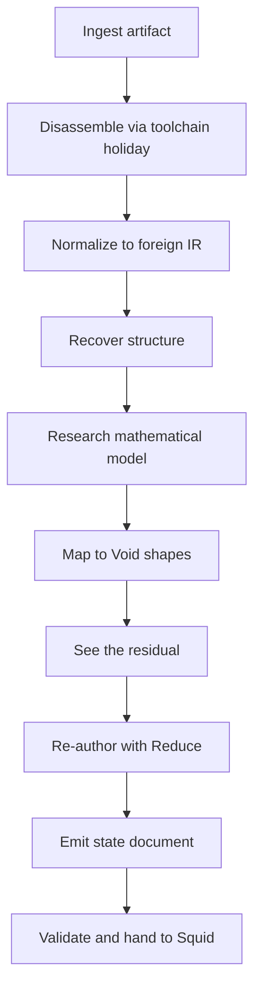

> **Status, honestly: the first vertical slice is built; the rest of the contract is not.**
> The pure library, the `effect molerat` ops and the synthetic toy-ledge run exist and pass
> (`ctest --test-dir build -R squid_`: 6 of 6). Answer application as one dispatcher
> `batch`, `resume`, `compose --commit` and a studio workspace do not. The rationale, the
> integration plan and the slice are in `molerat/design.md`. A `status:current` claim below
> carries a `resource:` link to the code or test that backs it; every other row stays
> `planned`.

# 1. What Void MoleRat is

**A forge, not an artifact.** MoleRat takes a target a person owns, recovers structure from
it, runs an explicit **research phase** that states the target's mathematical model, maps
that model onto the rune/mantle/domain vocabulary, and **re-authors** the result in the Void
idiom so [Void Squid](/index.md) can inspect, tag, lay out and play it.

It is the successor in spirit to [REA](/sources/rea-reverse-engineer-anything.md) and
[universal-modder](/sources/universal-modder.md), rebuilt in the Void way:

- it **assumes an agent is in the loop**, and it is the harness for that agent;
- it **targets mostly games**, and its output is for Void Squid;
- its goal is **faithful re-expression**, not byte-perfect cloning: understand the original
  system deeply, map it onto structures the family already has, and recreate the codebase in
  that idiom;
- it is therefore a **decompilation tool and a reformatting tool** at once.

# 2. What it is not

- Not a replacement for Ghidra, REA, `ndstool`, splat, decomp-toolkit or `um`. It discovers
  and invokes them through the **ingress toolchain** row of the
  [build surface](/concepts/build-surface.md), never links them.
- Not a matching decompiler. A community decompilation is an **oracle to cite**, not a loop
  to reimplement ([matching decompilation](/sources/matching-decompilation-and-recompilation.md)).
- Not a second brain. No model is embedded. A local model through Void Bicho is a holiday
  whose output is a proposal.
- Not a runtime and not a second Void Core. It never computes the target's results
  (`VoidCore:/design/what-voidcore-is-not.md` §4).
- Not an artifact. It ships nothing to a target; the artifact never ships the forge
  ([railguard](/design/what-voidsquid-is-not.md) §6).

# 3. The pipeline



The stages reach the four depths already named in [decompilation](/design/decompilation.md)
§3 — `bytes`, `opaque`, `source`, `structure` — and every piece records the depth its oracle
actually supports.

# 4. The four verbs, twice

The forge's verbs are **gather, compose, see the residual, build**. The research phase has
the same shape over knowledge, which is the design's spine:

| forge verb | research verb | what it produces |
|---|---|---|
| **gather** | gather the literature and the evidence | citations, a bounded structure summary, tool provenance |
| **compose** | compose a model and a mapping | `domain`, `operations`, `laws`, `composition`, `observation`; target construct → Void shape |
| **see the residual** | name what does not map | what, why, evidence, confidence, closest Void shape |
| **build** | build the translation holiday | interface, channels, lifecycle, ownership, units, not covered |

The research phase is **not a prompt**. It is a bounded task with a schema, an evidence
rule and an acceptance gate. A model record states an algebra and its laws, not a feeling.

# 5. Where the research lives

Research records are **runes** in one mantle per run (`molerat:<run>`), because runes are
tagged, linked and queryable with the tag grammar, and because the document is where
accepted truth lives; once the document is opened, every edit is journalled and undoable
(the emission itself is one effectful `build` write, not a journal entry). One mantle per
run is forced by the current link contract: v1 links are rune↔rune within one mantle
(`VoidCore:/SPEC.md` §3.7, read 2026-10-18).

| glyph | kind | carries |
|---|---|---|
| `molerat.target` | entity | what was taken apart, its depth and provenance |
| `molerat.model` | entity | the mathematical model |
| `molerat.mapping` | entity | one row of the translation |
| `molerat.residual` | entity | one thing that did not map |
| `molerat.holiday` | entity | the contract for what runs as the original |
| `molerat.task` / `molerat.answer` | entity | **planned** — the slice returns a task as JSON and stores a validated answer as `answers/NNN.json`; the runes are not emitted yet |

The five research runes (`target`, `model`, `mapping`, `residual`, `holiday`) are emitted
today. `task`/`answer` are the planned rune form of the harness; the exchange and its
validation are current, the rune record is not.

The OKF projection (`molerat/out/<run>/research.md`) is generated, not authored, and cites
sources by ordinary body link so `linked from` names the blast radius. Runes are the record;
the page is the durable, cross-bundle view.

# 6. Reduce's role, and its real limit

[Reduce](/concepts/dispatcher.md) is the re-expression engine for **normalization and
composition**: the mapped mantle becomes a net, `annihilate` removes scaffolding, `commute`
flattens, `patch` carries table values and units into measure content, and a `box` lets a
recovered subsystem be one rune in the emitted world.

It is **not** the retyping engine. Void Core's `patch` is content-only: it keeps the
survivor's id, glyph, arity, tags and wiring, and cannot turn a target-function agent into a
game-act agent. The data-form `expand` and general rules are `planned`. Retyping is
therefore a pure, tested mapper function, and rule-driven retyping is a **proposed Core
extension**, gated behind the railguard, never a fork. (Recorded from
`../VoidCore/SPEC.md` §7 and the [Reduce](/concepts/dispatcher.md) contract, 2026-10-18.)

# 7. The agent harness

MoleRat embeds no model. The agent runs outside the process and exchanges **bounded tasks
and validated answers**:

```
effect molerat task <run>              the next bounded task
effect molerat answer <run> '<json>'   validate, then accept or refuse
```

An accepted answer is validated and stored under `answers/NNN.json`; there is no partial
accept and no direct write to the document. Applying an accepted answer to the document as
one `batch` of ordinary dispatcher commands — one undo frame, one journal entry, attributed
to the agent — is the **next seam**, planned and not claimed by this slice. A refused answer
returns `ok:false` and writes nothing. A toolchain (`rea`, `um`, `ndstool`) and a model
(Bicho) are holidays; their output is evidence, never truth.

# 8. The boundary

**Ships to Squid:** a valid `.squid` state document (game mantle, research mantle, declared
glyphs, links, measure quantities), the generated research projection, the residual, and
the provenance. **Stays in the forge:** the IR, raw tool output, caches, answers, raw
disassembly and model weights.

No game bytes and no decompiled code enter this repository. The first slice's target is a
synthetic fixture. The re-authored codebase is the work; a compiled game is the artifact and
carries no MoleRat and no Void Core.

# 9. Status

| part | status | resource |
|---|---|---|
| the concept and the design | **current** for the design, written 2026-10-18 | [`molerat/design.md`](../../molerat/design.md) |
| the first vertical slice (one synthetic target, one document, one handoff) | **current 2026-10-18** | [`tests/molerat_test.cpp`](../../tests/molerat_test.cpp), [`tests/headless_smoke.cpp`](../../tests/headless_smoke.cpp) |
| `squid_molerat` pure library | **current 2026-10-18** | [`src/molerat/molerat.hpp`](../../src/molerat/molerat.hpp), [`ir.cpp`](../../src/molerat/ir.cpp), [`research.cpp`](../../src/molerat/research.cpp), [`emit.cpp`](../../src/molerat/emit.cpp) |
| `effect molerat` ops | **current 2026-10-18** for gather, research, compose, residual, build, status, task, answer, verify | [`src/molerat/effect.cpp`](../../src/molerat/effect.cpp) |
| applying an accepted answer as one dispatcher `batch` | **planned** | — |
| `resume` and `compose --commit` | **planned** | — |
| a studio workspace | **planned**, after the answer-application seam | — |
| a Core or Maiz change | **none**; the missing host-verb seam is a finding, not a fork | — |

The page-level tag stays `status:planned`, because most of the page is still planned.
Only the slice and the code it proves are `current`, each with a `resource:` link. Raising
the page-level tag would claim the whole contract, which answer application, `resume`,
`compose --commit` and the studio do not yet meet.

**What was proved on 2026-10-18:** the fixture in
[`molerat/fixtures/toy-ledge/`](../../molerat/fixtures/toy-ledge/foreign.ir.json) ran
gather → research → compose → build, produced `molerat/out/toy1/toy1.squid` (gitignored,
reproducible from the fixture, run id and seed), and
`squid --state molerat/out/toy1/toy1.squid --json validate` returned `{"ok":true}`.
`molerat verify` passed all four checks, including "no IR embedded" and "synthetic
declared". A claim with no evidence was refused with `ok:false` and no `answers/` write;
a complete claim was stored as `answers/001.json`.

# 10. Related pages

- [Decompilation](/design/decompilation.md) — the four depths and the pipeline MoleRat
  extends.
- [Construct and deconstruct](/concepts/construct-and-deconstruct.md) — readers as the
  inverse of nibs; the ingress residual.
- [Recon](/concepts/recon.md) — the built zeroth stage MoleRat starts from.
- [Three uses](/design/three-uses.md) — decompile, create and simulate as workspaces over
  one document.
- [The forge for many runtimes](/design/the-forge-for-many-runtimes.md) — the forge's four
  verbs and the artifact line.
- [What Void Squid is NOT](/design/what-voidsquid-is-not.md) — the railguard MoleRat obeys.
- [What a game is](/concepts/what-a-game-is.md) — the nouns the re-authored output is
  written in.

# 11. Sources

- [REA](/sources/rea-reverse-engineer-anything.md) — orchestration over external engines;
  evidence and limitations per conclusion.
- [universal-modder](/sources/universal-modder.md) — the bridge contract, evidence levels,
  and the publish check.
- [Learned decompilers](/sources/learned-decompilers.md) — what a model can and cannot
  supply, and why behaviour is the oracle.
- [Matching decompilation](/sources/matching-decompilation-and-recompilation.md) — the
  source-depth oracle.
- [ECS](/sources/ecs-dungeon-siege-overwatch.md) — the algebra a mantle is projected into.
