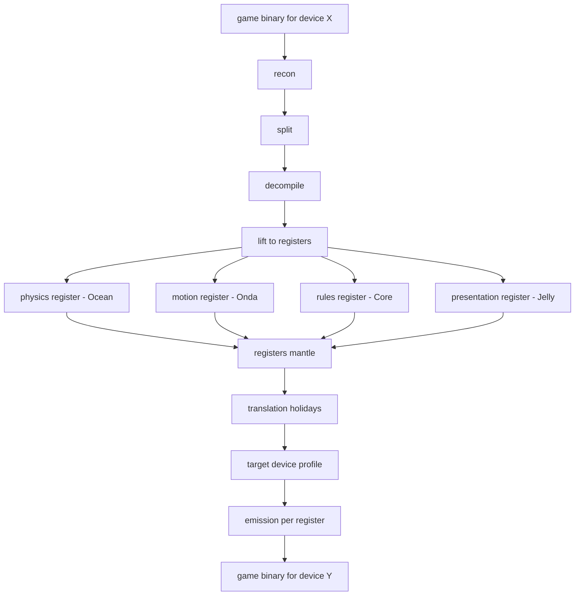
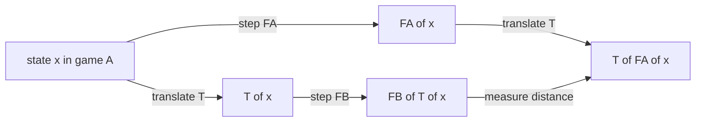

# The logic translation layer

> The author, 2026-10-28: *"we are not actually trying to use these tools JUST for mario
> galaxy … what we need is a translation layer into void ocean and void onda … then
> something to get it back onto any other device … sort of a compiler, but for a generic
> abstract device."* And: *"there's a lot more to translating logic than there may seem …
> there are infinite possibilities of logic."*

## 1. The problem, restated once

"Port the game's logic" is unbounded because *logic* is not one kind of thing. Minecraft's
logic is terrain and block rules; Galaxy's is planet gravity and a camera; a tycoon's is a
queue of interacting systems. Any single translation format is wrong for at least one of
them.

The resolution is to stop treating logic as one kind. The family has already split it, by
accident of history, into the right pieces:

| register | what it is | its pure home (built) |
|---|---|---|
| **physics** | forces, fields, collision, fluids | [Void Ocean](`../VoidOcean/okf/index.md`) — field, gravity, lift, translation |
| **motion** | clips and what they *mean* | [Void Onda](`../VoidOnda/okf/index.md`) — vocabulary of verbs, mixer, retarget, vision |
| **rules** | discrete transitions: event → response, state, inventory | [Void Core](`../VoidCore/okf/index.md`) — runes, mantles, interaction nets, [Reduce](`../VoidCore/okf/concepts/reduce.md`), plus Allomone |
| **presentation** | geometry, textures, draw lists | [Void Jelly](`../VoidJelly/okf/index.md`) — `.ink`, nibs, profiles, residual |
| **narrative** | beats, order, who plays | the game model ([what a game is](/concepts/what-a-game-is.md)), Turkey/Table/Feast |

A game is not "its logic" as one object. A game is **one mantle that references one
block per register**. That is the finite decomposition that makes the infinite problem
tractable: you do not model arbitrary logic; you model arbitrary logic *as belonging to
one of five registers, each with its own mathematics and its own oracle*.

## 2. A translation is per-register, and it is a holiday

[Ocean's translation](`../VoidOcean/okf/concepts/translation.md`) is the template for the
whole thing, and it is physics-only today. Generalise it:

For any register with a **state** and a **step function F**, a translation from game A to
game B is a map **T**, and it is honest exactly when it commutes:

```
defect(x) = ‖ T(F_A(x)) − F_B(T(x)) ‖
```

In Void Core's terms ([on Void Core](`../VoidOcean/okf/design/on-void-core.md`)): **a game's
physics is a mantle; a translation between games is a holiday; the defect is the holiday's
residual.** The same sentence applies verbatim to the other registers:

- **motion**: Onda's meaning dictionary is T — a game's clip names mapped onto shared verbs;
  the residual is the retargeting loss and the vision judge's pass rate.
- **rules**: a state-machine homomorphism between A's rule net and B's; the residual is the
  transitions that do not carry ([Reduce](`../VoidCore/okf/concepts/reduce.md`) as a *structure
  compiler*, never the runtime).
- **presentation**: Jelly's `emit(ink, profile)` already returns a residual — the geometry
  the target cannot hold.
- **narrative**: a beat is a rune; a table is a mantle; the residual is the beat with no
  home.

So "translate the logic" is not one compiler. It is **one holiday per register**, and each
holiday already has a home and a measurable residual. The whole port's faithfulness is the
vector of five residuals — not a feeling.

## 3. The abstract device is a profile of registers

The *egress* half of the compiler is already the same shape as Jelly's `emit(ink, profile)`
and Ocean's `look` (which writes GLSL as text for a host to compile). Generalise:

**A device is a set of per-register capabilities**: can it run Ocean fields? Onda clips?
interaction-net rules? native, or behind a holiday (emulator)? GL, Vulkan, or a terminal?

```
device profile = { physics: {gravity-model, fluid, ...}, motion: {...},
                   rules: {reduce, opaque-holiday}, presentation: {gl, vulkan},
                   narrative: {table, feast} }
```

The abstract-device compiler is then **profile-guided emission**: each register's pure
model emits to the device's per-register profile, and anything it cannot hold is named in
the residual. This is why the forge's `plan_route` already lists the cpu/gpu/audio/input/
storage/os bridges as data — that is the *code* register's profile. The same table, one row
per register, is the full compiler.

## 4. Where AI actually fits — propose and identify, never verify

The author's two floated ideas, placed honestly:

- **Vector space over logic systems** (embed every game's rules in high dimensions): right
  for *search and classification*, wrong for *correctness*. An embedding cannot prove a port
  works. Bicho's `embed` belongs on the **shelf** — "find a game whose physics resembles
  this one" — not in the translation itself.
- **NLP over game code**: the family already has a *discrete, verifiable* version — Onda's
  meaning vocabulary and Core's tag grammar. That is the NLP bridge that can be checked,
  because every line is a claim with a confidence, and the oracle (match loop, defect) can
  hold it.

The division of labour the pipeline wants:

| job | who | verified by |
|---|---|---|
| which register is this function? | Bicho `classify` | a person / rule accepts |
| propose a candidate translation | Bicho `propose` (built) + the agent | the match loop (built) |
| is the translation faithful? | the **defect / match loop**, never a model | compiler + oracle (built for compile-and-run) |
| where did it fail? | the residual | the commutation square |

This is exactly why the community's decompilation bans AI-*generated* source but allows AI
for naming: the model proposes, the verifier decides.

## 5. The whole pipeline, as one picture



The faithfulness of T is one square, drawn per register:



## 6. Super Mario Galaxy, mapped onto this

- **presentation**: already lifted — real planets, collision, rigs, audio play in the
  runtime ([the Goomba Galaxy exercise](/design/goomba-galaxy-exercise.md)).
- **physics**: Ocean's gravity model *is* Galaxy's gravity generalised; the 106 gravity
  fields already read into it.
- **motion**: Onda plays the recovered rigs and judges them.
- **rules** and **camera logic**: this is the gap. Petari's decomp is the source, the forge's
  match loop is the verifier, and the camera is the first function to carry across.

So the SMG logic port is no longer "reconstruct everything." It is "lift the rules register
and the camera, one function at a time, through the register model, each with a residual."

## 7. Open questions for the author

1. **Naming.** Does the register model get a sibling repository (e.g. *Void Puente* — the
   bridge), or live as a concept inside Void Squid with Ocean/Onda/Core/Jelly owning their
   registers?
2. **Is the rules register Reduce-shaped, or Allomone-shaped, or both?** Rules are discrete
   transitions; Reduce is a *structure compiler* and must never become the runtime. Which
   owns the game's own state machine?
3. **The defect over trajectories.** Ocean measures one step; the port needs it over whole
   plays. Does the forge's match loop gain a trajectory oracle (record a run, replay it)?
